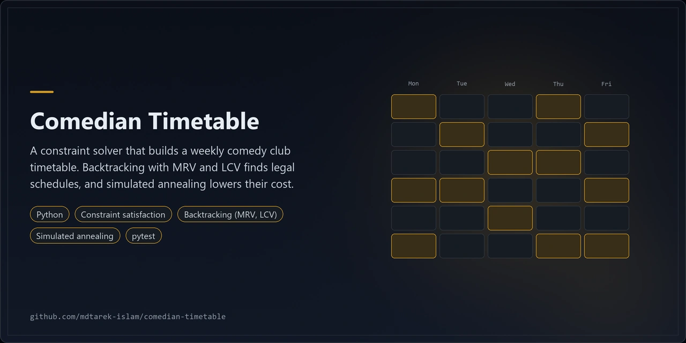
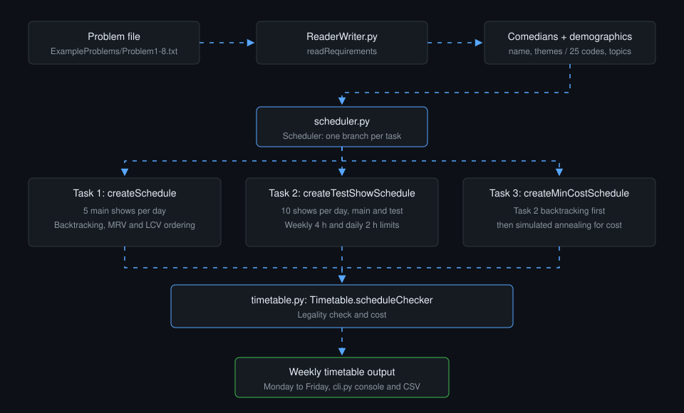
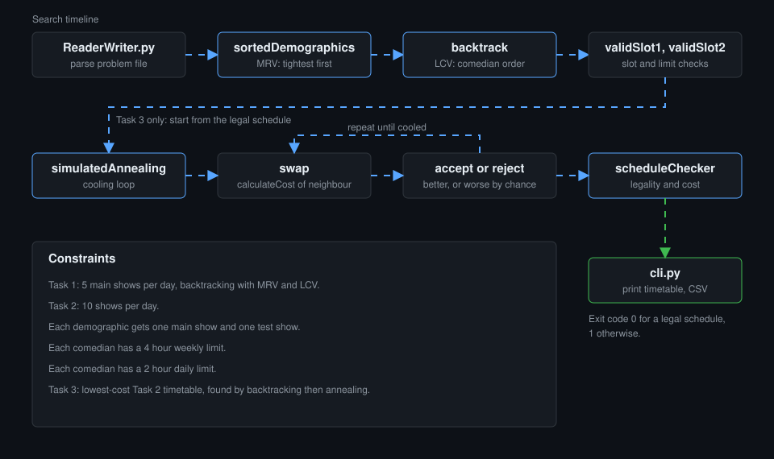

<p align="center"></p>

# Comedian Timetable

A constraint solver that builds a weekly comedy club timetable.

## Overview

Comedian Timetable is a constraint solver that builds a weekly comedy club timetable. Backtracking with MRV and LCV ordering finds legal schedules. Simulated annealing then lowers their cost. It began as coursework and runs on the Python standard library only.

| Layer | Technology |
|---|---|
| Language | Python 3 |
| Search | Constraint satisfaction, backtracking (MRV, LCV) |
| Optimisation | Simulated annealing |
| Tests | pytest |

## Architecture



1. `ExampleProblems/Problem1.txt` to `Problem8.txt` hold the comedians (name, themes) and 25 demographics (code, topics).
2. `ReaderWriter.py` parses a problem file into comedian and demographic objects.
3. `scheduler.py` runs one branch per task: backtracking for Task 1, constrained backtracking for Task 2, backtracking then simulated annealing for Task 3.
4. `timetable.py` holds the schedule. `Timetable.scheduleChecker` checks legality and computes cost.
5. `cli.py` prints the Monday to Friday timetable and can write it to CSV.



The second diagram follows one search from problem file to timetable, with the constraints the search must respect.

## Features

- Task 1: 5 main shows per day, using backtracking with MRV and LCV ordering.
- Task 2: 10 shows per day, one main and one test show per demographic. Each comedian has a 4 hour weekly and a 2 hour daily limit.
- Task 3: the lowest-cost Task 2 timetable, found by backtracking and then simulated annealing.
- Command line tool with a CSV export. The exit code is 0 for a legal schedule and 1 otherwise.
- Test suite for the reader, models, cost, schedules and CLI.

### Engineering findings

A 2026 review fixed 8 defects:

- `addTheme` was called on a list.
- `setReference` raised a `NameError`.
- Shared mutable default lists leaked state between objects.
- The backtrack filter for unassigned demographics compared a tuple to a `Demographic`.
- `validSlot2` compared weekly hours to the daily limit and accepted only 5-character codes.
- The simulated annealing acceptance test had an inverted sign.
- Swap options 2 and 3 never ran.

Results after the fixes. Each figure comes from a single run, so treat it as an observation, not a benchmark:

- All 8 problems give legal timetables.
- Task 3 cost on Problem1 fell from 15100 to 11475 in one run.
- Task 3 runs took about 10 to 26 s, down from 21 to 58 s.
- Problem4 showed no gain in one run.
- Tests: 43 passed and 7 skipped. The skipped tests are the slow Task 3 runs on Problems 2 to 8. With `RUN_SLOW=1`, those 7 passed in 63 s.

## Quick start

```bash
git clone https://github.com/mdtarek-islam/comedian-timetable.git
cd comedian-timetable
python cli.py --problem ExampleProblems/Problem1.txt --task 1
```

The solver needs Python 3 and no third-party packages. Install pytest only to run the tests:

```bash
pip install -r requirements-dev.txt
```

## Configuration

No configuration needed. Options are command line flags. The default problem is `ExampleProblems/Problem1.txt` and the default task is 1. Set `RUN_SLOW=1` to include the slow Task 3 tests.

## Usage

```bash
python cli.py --problem ExampleProblems/Problem1.txt --task {1,2,3} --output schedule.csv
```

| Flag | Meaning |
|---|---|
| `--problem` | Path to a problem file |
| `--task` | 1: main shows, 2: main and test shows, 3: minimum cost |
| `--output` | Optional CSV path for the schedule |

Run the tests:

```bash
python -m pytest
RUN_SLOW=1 python -m pytest
```

## Licence and contribution

This project uses the MIT licence. See [LICENSE](./LICENSE). Raise bugs and ideas as GitHub issues.

## Maintenance status

Experimental. The repository is a coursework-style solver with a working test suite, and it is not released for general use.
